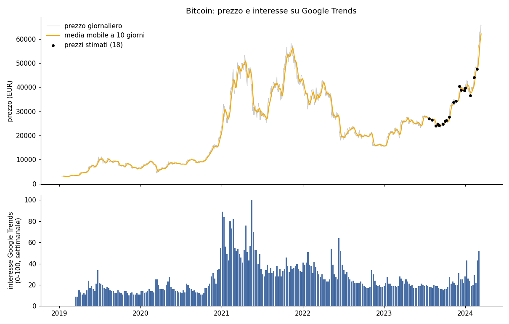
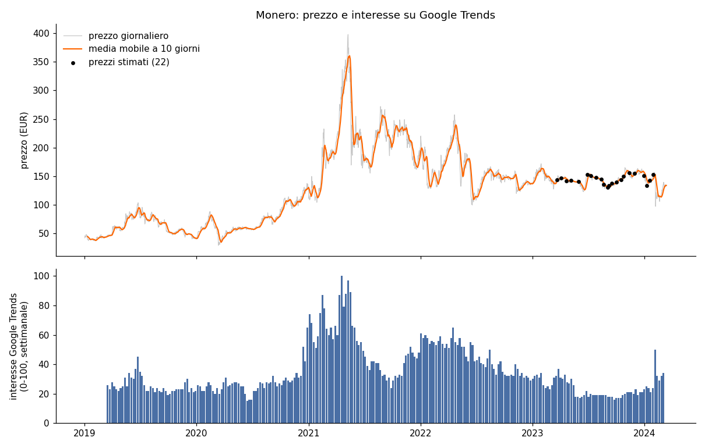

# Una pipeline E2E AWS per analizzare BTC e XMR
Progetto di data engineering che costruisce una pipeline ETL sull'ecosistema AWS: estrae, trasforma e carica i prezzi storici di Bitcoin (BTC) e Monero (XMR) insieme all'interesse per le due criptovalute su Google Trends, per analizzarli in parallelo in un database Amazon Redshift Serverless.

## Servizi utilizzati
- <strong>AWS S3</strong> (servizio cloud di archiviazione a oggetti), per i dati grezzi, i dati trasformati in formato Parquet e il codice dei job
- <strong>AWS Glue</strong> (servizio serverless per l'ETL), con job <em>Python shell</em>
- <strong>AWS Step Functions</strong> (servizio di orchestrazione, simile ad Apache Airflow), per eseguire le due pipeline in parallelo
- <strong>Amazon Redshift Serverless</strong> (data warehouse colonnare distribuito, nella versione serverless), interrogato tramite la <strong>Redshift Data API</strong>
- <strong>AWS Secrets Manager</strong> (gestione sicura dei segreti, come utenti e password di un database)
- <strong>AWS IAM</strong> (Identity and Access Management), per i permessi di job, macchina a stati e Redshift
- <strong>FastAPI</strong> e <strong>Uvicorn</strong> per l'API REST sui risultati
- <strong>pandas</strong> e <strong>PyArrow</strong> per le trasformazioni, <strong>boto3</strong> per S3 e Redshift, <strong>pytest</strong> per i test, <strong>Matplotlib</strong> per i grafici

# Obiettivi del progetto
- <strong>Acquisizione dei dati</strong>: caricare i file grezzi sui prezzi delle criptovalute (BTC e XMR) e su Google Trends in un bucket S3.
- <strong>Pulizia e trasformazione</strong>: gestire i prezzi non validi (-1), convertire i dati in formato Parquet e calcolare la media mobile a 10 giorni per ridurre il rumore dei prezzi.
- <strong>Unificazione dei dataset</strong>: unire prezzi e Google Trends tenendo conto della diversa granularità temporale (giornaliera e settimanale).
- <strong>Caricamento e analisi</strong>: caricare i dati finali in Amazon Redshift, pronti per query SQL e dashboard (per esempio con Amazon QuickSight).
- <strong>Orchestrazione</strong>: automatizzare l'intero processo con AWS Step Functions, con due pipeline parallele e indipendenti, una per BTC e una per XMR, e uno stato di errore per ogni fase.

# Architettura
```
data/*.csv --(src/carica_su_s3.py)--> s3://progettoaws-raw/dataset/
                                                 |
                 Step Functions: due rami paralleli (BTC, XMR), ognuno con tre job Glue
                                                 |
   1. prepara_dati    CSV grezzi -> s3://progettoaws-argento/<moneta>/prezzi_puliti.parquet, trend.parquet
   2. unisci_trend    -> s3://progettoaws-argento/<moneta>/prezzi_giornalieri.parquet, settimanale.parquet
   3. carica_redshift -> Redshift Serverless: <moneta>.prezzi_giornalieri, <moneta>.settimanale
```
`<moneta>` è `bitcoin` oppure `monero`: anche in Redshift ogni moneta ha il proprio schema. I tre job sono gli stessi per entrambe le monete, che vengono scelte con il parametro `--CRIPTO`: per aggiungere un'altra criptovaluta basta una riga in `CRIPTO` in `src/cripto.py`.

# Repository
```
aws/
├── src/
│   ├── cripto.py          # tutta la logica della pipeline: trasformazioni, S3, Redshift
│   ├── carica_su_s3.py    # carica su S3 i CSV grezzi e il codice dei job
│   └── api.py             # API REST (FastAPI) sui risultati della pipeline
├── glue/                  # job Glue (Python shell), uno per fase, parametrizzati per moneta
│   ├── prepara_dati.py
│   ├── unisci_trend.py
│   └── carica_redshift.py
├── orchestration/
│   ├── pipeline.asl.json        # definizione della macchina a stati di Step Functions
│   └── stepfunctions_graph.svg  # grafo della macchina a stati
├── sql/
│   ├── tabelle.sql        # schemi e tabelle di Redshift (generato da cripto.ddl())
│   └── analisi.sql        # query di esempio
├── infra/                 # policy IAM di esempio per i job Glue e per Step Functions
├── data/                  # CSV grezzi: prezzi giornalieri (Investing.com) e Google Trends settimanale
├── images/                # grafici prodotti da analisi_locale.py
├── notebooks/risultati.ipynb  # notebook con tutti i risultati, già eseguito
├── tests/
│   ├── test_cripto.py
│   └── test_api.py
├── analisi_locale.py      # esegue l'intera pipeline in locale, senza AWS
├── requirements.txt
└── pytest.ini
```

# Workflow
<strong>1. Preparazione dei dati</strong> (`glue/prepara_dati.py`)
- Lettura dei CSV da S3. Date e numeri vengono letti con il formato dichiarato: date mese/giorno/anno (`03/12/2024` è il 12 marzo) e virgola come separatore delle migliaia nei prezzi di BTC (`65,619.5`).
- Controllo di qualità: date duplicate, giorni mancanti e prezzi non validi, riportati nel log del job.
- Ordinamento per data: i file originali sono in ordine decrescente.
- Sostituzione dei prezzi non validi (-1) per <strong>interpolazione</strong> tra il giorno valido precedente e quello successivo. I giorni stimati sono segnalati nella colonna `prezzo_stimato`.
- Scrittura in Parquet dei prezzi puliti e dei trend.

<strong>2. Unione con Google Trends</strong> (`glue/unisci_trend.py`)
- <strong>Media mobile a 10 giorni</strong> sul giorno stesso e sui 9 precedenti, mai sui giorni futuri.
- Ogni valore di Google Trends si riferisce alla settimana che <strong>inizia</strong> quella domenica. I prezzi vengono quindi aggregati sulla stessa settimana, da domenica a sabato (prezzo medio, prezzo di chiusura, variazione percentuale rispetto alla settimana precedente), e uniti all'interesse. Si tengono solo le settimane complete.
- Scrittura in Parquet delle tabelle finali `prezzi_giornalieri` e `settimanale`, con le date in formato `DATE` leggibile da Redshift.

<strong>3. Caricamento su Redshift</strong> (`glue/carica_redshift.py`)
- Con la Redshift Data API vengono eseguiti `DELETE` e `COPY ... FORMAT AS PARQUET` per ogni tabella, in un'unica transazione: rieseguire la pipeline sostituisce i dati invece di duplicarli, e se `COPY` fallisce le tabelle restano come prima.
- Le credenziali del database vengono lette da <strong>Secrets Manager</strong> oppure ottenute con il ruolo IAM del job: nel codice non ci sono password, endpoint o ID dell'account.

<strong>4. Orchestrazione</strong> (`orchestration/pipeline.asl.json`)
- Uno stato `Parallel` con un ramo per moneta. Ogni fase usa `glue:startJobRun.sync`, quindi attende la fine del job prima di passare alla successiva.
- Ogni fase ha dei tentativi automatici in caso di errori temporanei di Glue e un `Catch` verso lo stato di errore della propria pipeline (`Fail BTC`, `Fail XMR`).

### Correzioni rispetto alla prima versione
- I valori -1 venivano sostituiti con prezzi molto sbagliati, in mediana del 72% più bassi per BTC e del 56% per XMR. Il ciclo riordinava il DataFrame durante la sostituzione, ma continuava a usare le posizioni delle righe nell'ordine originale. Per esempio il prezzo BTC del 10/02/2024 (circa 44.000 €) diventava 3.154 €, la media di 5 prezzi del 2019. Gli errori finivano nella media mobile: 22 settimane su 260 per BTC e 28 per XMR avevano la media mobile sbagliata di oltre l'1%, fino al 14%.
- La media mobile veniva calcolata prima dell'ordinamento per data: era corretta solo perché il ciclo precedente aveva riordinato i dati. Senza valori -1 avrebbe usato i giorni futuri.
- Il join confrontava l'interesse della settimana con il solo prezzo della domenica, cioè con una media mobile dei 10 giorni *precedenti* la settimana.
- Lo script di caricamento su S3 si fermava al primo file, perché `progettoaws-raw/dataset` non è un nome di bucket valido e l'errore `ParamValidationError` non era gestito. Caricava inoltre i file in cartelle diverse da quelle lette dai job.
- `COPY` aggiungeva le righe a ogni esecuzione, duplicando i dati. La tabella di Monero era nello schema `bitcoin` e mancava la definizione delle tabelle.
- La password del database era nel codice e la macchina a stati era disponibile solo come immagine.

# Configurazione su AWS
Passi da eseguire una volta. Nomi di bucket, job e workgroup sono quelli usati come esempio e si possono cambiare.

1. <strong>Bucket S3</strong>: `progettoaws-raw` per dati grezzi e codice, `progettoaws-argento` per i Parquet.
2. <strong>Dati e codice</strong>, dalla cartella del progetto e con le credenziali AWS configurate:
   ```bash
   python src/carica_su_s3.py --bucket progettoaws-raw --codice
   ```
3. <strong>Redshift</strong>: eseguire `sql/tabelle.sql` nel query editor. Il ruolo IAM associato al namespace deve poter leggere `progettoaws-argento`: serve per `COPY`, ed è il valore di `--RUOLO_IAM`, oppure `default` se è il ruolo predefinito del namespace.
4. <strong>Credenziali</strong>: un segreto di Secrets Manager con `username` e `password` del database, oppure l'accesso con IAM (`--SECRET_ARN iam`).
5. <strong>Ruoli IAM</strong>: uno per i job Glue e uno per la macchina a stati, a partire dalle policy in `infra/` (sostituire i segnaposto `<REGIONE>`, `<ACCOUNT_ID>`…). Tra le due istruzioni `CredenzialiRedshift` e `SegretoRedshift` basta quella del metodo di accesso scelto.
6. <strong>Job Glue</strong>: tre job *Python shell*, con Python 3.9 e le librerie di analisi caricate (pandas, PyArrow), concorrenza massima 2, perché i due rami eseguono lo stesso job in contemporanea, e il parametro `--extra-py-files s3://progettoaws-raw/codice/cripto.py`:

   | Job | Script | Parametri |
   |---|---|---|
   | `cripto-prepara-dati` | `codice/prepara_dati.py` | `--BUCKET_RAW progettoaws-raw`, `--PREFISSO_RAW dataset`, `--BUCKET_ARGENTO progettoaws-argento` |
   | `cripto-unisci-trend` | `codice/unisci_trend.py` | `--BUCKET_ARGENTO progettoaws-argento` |
   | `cripto-carica-redshift` | `codice/carica_redshift.py` | `--BUCKET_ARGENTO`, `--WORKGROUP`, `--DATABASE`, `--RUOLO_IAM`, `--SECRET_ARN` |

   `--CRIPTO` viene passato dalla macchina a stati.
7. <strong>Step Functions</strong>: creare una macchina a stati con la definizione `orchestration/pipeline.asl.json` e avviarla.

<strong>Da collaudare</strong>: il codice è stato verificato in locale, con i test e con l'esecuzione completa sui dati del repository, ma non su un account AWS. Vanno verificati in particolare la versione di pandas disponibile nei job Python shell (il codice è compatibile con pandas 1.3 e successivi), i permessi IAM e l'esecuzione di `COPY` sui file Parquet.

# Esecuzione in locale
Serve Python 3.9 o successivo. Dalla cartella del progetto:
```bash
python -m pip install -r requirements.txt
python analisi_locale.py     # pipeline completa sui CSV di data/: Parquet in output/, grafici in images/
python -m pytest             # test
python -m jupyter lab notebooks/risultati.ipynb   # notebook dei risultati
python -m uvicorn api:app --app-dir src           # API REST su http://localhost:8000
```
I test usano i dati reali del repository e client S3 e Redshift simulati in memoria. Controllano tra l'altro che i prezzi stimati stiano tra quelli dei giorni vicini, che la media mobile usi solo il passato e che la DDL corrisponda alle colonne dei Parquet.

# API REST
L'API espone i risultati della pipeline. Avvio, dalla cartella del progetto e con le dipendenze installate:
```bash
python -m uvicorn api:app --app-dir src --host 0.0.0.0 --port 8000
```
La documentazione interattiva, da cui si possono provare le richieste, è su http://localhost:8000/docs.

| Metodo | Percorso | Descrizione |
|---|---|---|
| GET | `/health` | verifica che il servizio sia attivo |
| GET | `/monete` | monete disponibili, periodo coperto, giorni con prezzo stimato |
| GET | `/monete/{moneta}/prezzi` | prezzi giornalieri puliti e media mobile a 10 giorni; con `solo_stimati=true` solo i giorni con prezzo stimato |
| GET | `/monete/{moneta}/settimanale` | prezzi settimanali e interesse su Google Trends |
| GET | `/monete/{moneta}/statistiche` | correlazioni tra prezzo e interesse e interesse medio per ampiezza della variazione settimanale |
| GET | `/confronto` | Bitcoin e Monero settimana per settimana, con le correlazioni tra le due monete |

`{moneta}` può essere `btc`, `xmr`, `bitcoin` o `monero`. Tutti gli endpoint tranne `/health` e `/monete` accettano i filtri `dal` e `al` (date nel formato AAAA-MM-GG, estremi inclusi). Esempio:
```bash
curl "http://localhost:8000/monete/btc/statistiche?dal=2023-01-01"
```
```json
{
  "moneta": "bitcoin",
  "dal": "2023-01-01",
  "al": "2024-03-03",
  "settimane": 62,
  "correlazione_prezzo_interesse": 0.703,
  "correlazione_variazioni": 0.516,
  "correlazione_variazione_assoluta_interesse": 0.391,
  "interesse_per_variazione": [
    {"variazione_settimanale": "meno del 5%", "settimane": 42, "interesse_medio": 20.3},
    {"variazione_settimanale": "dal 5 al 10%", "settimane": 10, "interesse_medio": 26.5},
    {"variazione_settimanale": "oltre il 10%", "settimane": 10, "interesse_medio": 24.9}
  ]
}
```
I filtri permettono di vedere come cambiano le relazioni nel tempo. Dal 2023, per esempio, le variazioni settimanali di prezzo e interesse di Bitcoin hanno correlazione 0,52, mentre sull'intero periodo è praticamente nulla (-0,03). Su periodi brevi le stime sono però basate su poche settimane: 62 in questo esempio, solo 10 per classe di variazione. Le correlazioni non calcolabili, per esempio su un periodo senza dati, sono `null`. Richieste non valide, come una moneta sconosciuta (404) o `dal` successivo ad `al` (422), ricevono un errore con il dettaglio del problema.

Configurazione tramite variabili d'ambiente:
- `CRIPTO_DATI`: da dove leggere le tabelle.
  - Se non è impostata, le tabelle vengono calcolate all'avvio dai CSV di `data/`, in meno di un secondo: l'API funziona subito dopo il clone.
  - Una cartella con i Parquet della pipeline, per esempio `output` prodotta da `analisi_locale.py`.
  - `s3://progettoaws-argento`, il bucket in cui scrivono i job Glue, con le credenziali AWS configurate e il permesso `s3:GetObject`.
- `CRIPTO_API_KEY`: se impostata, tutte le richieste tranne `/health` devono contenere l'header `X-API-Key` con questo valore, altrimenti ricevono errore 401.

I dati vengono letti una sola volta, all'avvio: dopo una nuova esecuzione della pipeline basta riavviare il servizio. In produzione il servizio va esposto tramite HTTPS, per esempio dietro un reverse proxy.

# Risultati
Tutti i risultati, con il confronto tra il metodo di pulizia originale e quello corretto, sono nel notebook [`notebooks/risultati.ipynb`](notebooks/risultati.ipynb), che esegue la stessa logica dei job Glue sui CSV del repository.
### Qualità dei dati
| | Bitcoin | Monero |
|---|---|---|
| Periodo dei prezzi | 12/01/2019 – 12/03/2024 | 01/01/2019 – 12/03/2024 |
| Giorni | 1.887 | 1.898 |
| Giorni mancanti o duplicati | 0 | 0 |
| Prezzi non validi (-1) | 18 | 22 |
| Settimane di Google Trends | 260 (17/03/2019 – 03/03/2024) | 260 |

I prezzi non validi sono tutti concentrati nell'ultimo anno: dal 22/07/2023 al 23/02/2024 per BTC e dal 22/03/2023 al 30/01/2024 per XMR.




### Prezzo e interesse su Google Trends
| | Bitcoin | Monero |
|---|---|---|
| Correlazione tra prezzo medio settimanale e interesse | 0.61 | 0.62 |
| Correlazione tra variazione settimanale del prezzo e variazione dell'interesse | -0.03 | 0.03 |
| Correlazione tra variazione del prezzo in valore assoluto e interesse | 0.38 | 0.36 |

Interesse medio per classe di variazione settimanale del prezzo (query 3 di `sql/analisi.sql`):

| Variazione settimanale | Bitcoin: settimane | Bitcoin: interesse medio | Monero: settimane | Monero: interesse medio |
|---|---|---|---|---|
| meno del 5% | 140 | 22.4 | 115 | 31.3 |
| dal 5 al 10% | 58 | 27.7 | 77 | 33.4 |
| oltre il 10% | 62 | 34.6 | 68 | 43.8 |

- Prezzo e interesse sono correlati (0,6), ma soprattutto perché seguono gli stessi cicli di lungo periodo. Per Monero prezzo e interesse raggiungono il massimo insieme, ad aprile-maggio 2021. Per Bitcoin il prezzo tocca il massimo a marzo 2024, ma l'interesse medio del 2024 (31) resta sotto quello del 2021 (47): il nuovo record di prezzo non ha riportato l'attenzione ai livelli del 2021.
- L'interesse non indica la <strong>direzione</strong> del prezzo: le variazioni settimanali dei due non sono correlate.
- L'interesse cresce con l'<strong>ampiezza</strong> dei movimenti del prezzo, al rialzo o al ribasso. Nelle settimane con variazioni oltre il 10% l'interesse medio per Bitcoin è superiore del 54% rispetto alle settimane con variazioni sotto il 5%. La settimana di massimo interesse per Bitcoin (100, 16/05/2021) è anche la quinta peggiore su 260, con il -20%.
- I prezzi delle due monete si muovono insieme anche settimana per settimana: la correlazione delle variazioni settimanali è 0,67.
